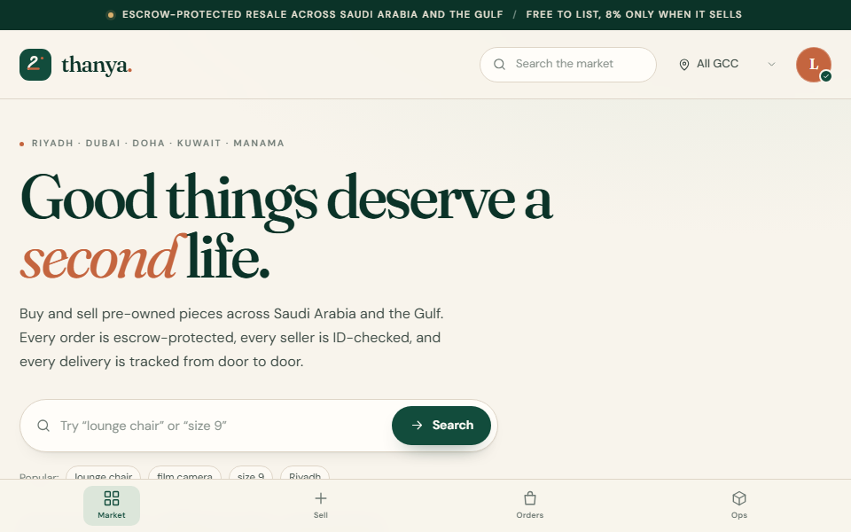

# Thanya

**A GCC resale marketplace with escrow checkout, seller listings and an operations console.**

[Live demo](https://gulf-resale-022118409754202576314.vercel.app) | HTML, CSS and JavaScript, no build step



A buyer-first seeded market of pre-owned pieces across Riyadh, Jeddah, Dubai, Doha, Kuwait City and
Manama. Buyers can search, save and pay through escrow; sellers can list with photos and see their
fees; operations can verify sellers and settle the escrow ledger.

## What it does

- **Nine seeded listings** across six GCC cities, with search plus category and city filters.
- **Listing detail and saved items**, so a buyer can compare before committing.
- **Escrow checkout.** The payment is held, then released when the order is confirmed.
- **Order tracking**, with a release step rather than a simple "paid" badge.
- **A seller composer.** Photo upload, price and fee calculation before the listing goes live.
- **An operations console.** Seller verification queue and the escrow ledger in one view.

## Run it locally

```bash
node dev-server.mjs
```

Open <http://127.0.0.1:4173>. Nothing to install.

## Verify

```bash
node check.mjs
node smoke.mjs
```

`check.mjs` covers the data model, fees and escrow transitions. `smoke.mjs` serves the app and walks
the browse, detail, checkout and console routes over HTTP.

## How it is built

| Path | Purpose |
|---|---|
| `index.html` | Marketplace, listing detail, checkout, seller composer and console |
| `app.js` | Views, filters, escrow state, forms and the operations console |
| `styles.css` | The visual system and responsive layout |
| `check.mjs` | Data and escrow verification |
| `smoke.mjs` | Route smoke test |

## What is simulated

Sample data only. Payments, identity checks, delivery and tracking are simulated, and the sellers,
listings and orders are seeded.

## About this prototype

Built as a working prototype for a real brief, then published as part of a portfolio. The escrow
ledger is the interesting part: money is held and released as a state machine, not as a mock payment
screen.
